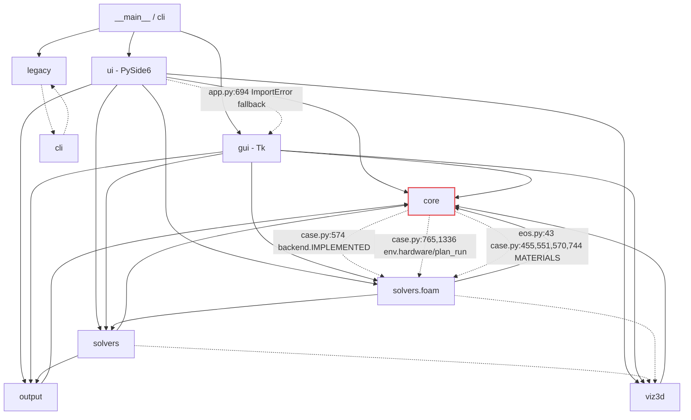

# blastlab - architecture review and migration plan

Written 2026-09-24 from static reading only (no GUI built, no WSL solve run,
per CLAUDE.md §8.2 and §8.6). Every path is relative to the repo root; every
line number is from the tree at commit `e5b4002` on branch `hd1-band-cost`.

Binding constraints this plan respects (CLAUDE.md §9 and the task brief):

- `blastlab/gui/` (Tkinter + customtkinter) is the permanent way back behind
  `python -m blastlab --tk`. No phase deletes, deprecates or reworded-retires it,
  and every change to a shared module keeps the Tk GUI working.
- `blastlab/tests/baseline/`, `foam_fixtures/`, `foam_golden/`, `DONE.md` §5/§7,
  solver defaults and committed tests are not touched. `test_regression.py`
  stays byte-identical throughout.
- The Qt process never imports VTK (`test_ui_no_vtk_in_main.py`) or
  `matplotlib.pyplot` (`test_ui_no_mpl_pyplot.py`); the 3D viewer stays a child
  process.
- The four WSL constants at the top of `blastlab/solvers/foam/env.py` are
  load-bearing.
- `TODO.md` and `DONE.md` keep their names (15 code comments cite them).
- Structure only: user inputs, numbers and file formats stay identical.

---

## 1. Snapshot

**Size.** 229 Python files under `blastlab/`, 82,129 lines. Roughly 43,500 lines
of application code and 38,600 lines of tests (two of the test files are the
3,190-line Tk and 3,422-line Qt QA harnesses).

| Package | Lines | Role |
|---|---|---|
| `core/` (27 files) | 10,015 | constants, EOS, Riemann fluxes, BC, grids, profiles, refinement plan, hardware model, settings, **the Case dataclasses + `validate_case`** (`case.py`, 1,522), the HD1.3 track (`deflagration`, `sdof`, `vent`, `room`, `thermal`, `unconfined`, `sensitivity`, `qd`, `wallload`, `assessment`) |
| `solvers/` (7 files) | 2,312 | native 1D/2D/3D drivers, `hooks.py` (RunHooks/Result), `worker.py` (thread + queue), `jobs.py` (one run stage) |
| `solvers/foam/` (13 files) | 8,457 | the blastFoam backend: `backend.py` 2,280, `writer.py` 2,043, `runloop.py` 1,145, `env.py` 1,034, `reader.py`, `runner.py`, `postmortem.py`, `materials.py`, `dicts.py`, `runs.py`, `export_vtk.py`, `cli_run.py` |
| `output/` (11 files) | 2,409 | gauge TSVs, matplotlib figures, animation, HTML reports, gauge summary, HD1.3 CLI |
| `gui/` (15 files) | 6,259 | Tk app (the way back) |
| `ui/` (27 files) | 9,933 | PySide6 app, the main GUI |
| `viz3d/` (8 files) | 2,612 | viewer child process (`viewer.py` 1,711, the only pyvista module) + shared-memory protocol + numpy sampling |
| `legacy/` + root `blast1d/2d/3d.py` | 697 + 41 | the historical script API, which `tests/make_baseline.py` drives |
| `cli.py`, `__main__.py` | 837 | prompt workflow and the argparse entry |

**Entry points.** `python -m blastlab` -> `blastlab/__main__.py:main` (Qt by
default; `--tk`, `--cli 1d|2d|3d`, `--hd13`, `--hd13-new`, `--clean-foam-runs`,
`--reap-foam-runs`, `--load-foam-run`); `pyproject.toml` `[project.scripts]
blastlab = "blastlab.__main__:main"`; `blastlab_qt.bat`, `blastlab.bat`; root
`blast1d.py`/`blast2d.py`/`blast3d.py` are star-import shims onto
`blastlab.legacy.*`.

**Frameworks.** numpy; PySide6 + pyqtgraph (`ui/`); tkinter + customtkinter
(`gui/`); matplotlib (`output/`, exports, previews); pyvista/VTK (only in
`viz3d/viewer.py`, child process); WSL subprocesses (`solvers/foam/`).

**Tests.** 78 `test_*.py`, 31 `_e2e_*.py`, 4 `_qa_*.py`. They are plain scripts
(`cd blastlab/tests && python test_X.py`). 72 are guarded by
`if __name__ == '__main__'`; six run their whole suite at *import* time and
`sys.exit(1)` on failure - `test_blast2d.py` (`274-279`), `test_blast3d.py`
(~12 min), `test_viz3d_panel.py`, `test_viz3d_sampling.py`,
`test_viz3d_hooks.py`, `test_viz3d_scene.py`. Only **6 files** define
top-level `def test_*` functions that pytest collects: `test_foam_amr_ingest.py`,
`test_foam_ingest_order.py`, `test_refine.py`, `test_vent_wall.py`,
`test_wallload.py`, `test_write_budget.py` (44 functions). The other 72
use a `check()`/`main()` pattern that pytest imports but does not run, so a
bare `python -m pytest blastlab/tests` today reports 44 tests, silently skips
the physics suites, and would execute the six unguarded ones during
collection. The byte-level gate, `test_regression.py`, reruns
`make_baseline.run()` (five native cases through the **legacy** API
`blast1d.run_blast`, `blast2d.run_blast_2d`, `blast3d.run_blast_3d`) and
compares eight files in `tests/baseline/`, including `transcript.txt` - the
captured stdout - so the `print` calls in `core/profiles.py:39,205,217` are
byte-pinned too. Case generation for blastFoam is pinned by
`test_foam_writer.py` against `tests/foam_golden/`.

**Shape in one paragraph.** The numerics are already separated from the
toolkits: no module in `core/`, `solvers/` or `output/` imports tkinter,
customtkinter or PySide6, both GUIs drive the same `solvers/worker.py` thread
and tagged-tuple queue, and the blastFoam boundary (dictionaries, parsing,
driving, materials) lives entirely in `solvers/foam/`. What is not separated
is the *middle*: `core/case.py` is simultaneously the model (three
dataclasses + JSON), the validator (a 623-line `validate_case`) and the place
that reaches *upward* into `solvers/foam/{backend,env,materials}` for
capability and hardware facts; results travel as `Result(snapshots: dict,
gauges: dict, meta: dict)` whose ~25 `meta` keys are read by name in six Qt
modules and the Tk results panel; the form-to-case mapping is written twice
(Tk and Qt); and the HD1.3 track is a second product with its own case type,
serialiser and CLI, glued to the GUI by `dim == 0` checks. The Qt export path
was already lifted into a toolkit-free module (`ui/exports.py`), which is the
pattern the rest of the plan repeats.

---

## 2. Dependency map

Package-level graph of the application (tests omitted). Solid arrows are
top-level imports, dashed arrows are deferred (inside a function). The
labelled dashed edges out of `core` are the layering inversions discussed
in §3.



**Circular imports found (all closed with deferred imports, so they work,
but each one is a hidden ordering constraint):**

1. `core/case.py` <-> `solvers/foam/backend.py` - `case.py:574` imports
   `backend` to read `IMPLEMENTED`; `backend.py:291,807` import `core.case`.
   Importing `backend` pulls in `runloop`, `runner`, `reader`, `writer`, `env`,
   `dicts` (about 7,000 lines) the first time a blastFoam case is validated.
2. `core/case.py` -> `solvers/foam/env.py` -> `core/{constants,hardware,settings}`
   (`case.py:765,1336`; `env.py:32-40,351,387,583,601,828`).
3. `core/eos.py:43` and `core/case.py:455,551,570,744` -> `solvers/foam/materials.py`.
   `materials.py` imports nothing from the project, so this is a wrong-home
   problem rather than a runtime cycle - but it is the reason `core` cannot be
   declared "imports nothing above it".
4. `core/case.py` <-> `core/chain.py` - `chain.py:4` imports `validate_case`
   at module level; `case.py:1193` imports `chain` deferred.
5. `solvers/foam/backend.py` <-> `solvers/foam/runloop.py` - `backend.py:32-34`
   top-level; `runloop.py:692` deferred.
6. `cli.py` <-> `legacy/blast{1,2,3}d.py` - `cli.py:721-725` deferred;
   `legacy/blast1d.py:116`, `blast2d.py:188`, `blast3d.py:231` top-level.

**GUI-to-calculation coupling.** None in the forbidden direction: no file
under `core/`, `solvers/`, `output/` or `viz3d/` (apart from the viewer child
itself) imports tkinter, customtkinter or PySide6. The two plotting imports in
the solver layer are `solvers/hooks.py:257` (matplotlib, console live view,
deferred) and `output/live.py:8` (`matplotlib.pyplot`, CLI only). The one
cross-toolkit edge is `ui/app.py:692-694`: the Qt window falls back to
`from ..gui.run_browser import dims_from_case_json` on `ImportError`. The
fallback is dead (`ui/run_browser.py` exists and re-exports the name from
`solvers/foam/runs.py:43`), but it is the only line that would make the Qt app
import customtkinter.

**blastFoam boundary check** (blastFoam User Guide v6.0, registered in
`docs/references/INDEX.md`). The solver vocabulary the guide defines -
`fluxScheme` (sec. 10.1), `activationModel`/`afterburnModel` (5.6.1, 5.6.2),
`errorEstimator`/`Lohner`/`densityGradient` (ch. 11), `blastProbes` (sec. 15),
`setRefinedFields` (sec. 16), `writeInterval`, `blockMesh`, `HLLC`,
`programmedIgnition` - appears in **zero** files under `ui/` and `gui/`. It is
confined to `solvers/foam/{writer,backend,runloop,reader,runner,dicts,
materials,env}.py`, plus validation wording in `core/case.py` (19 hits) and
the estimator name list in `core/refine.py` (8 hits). The boundary exists and
is clean; the plan does not need to create it, only to stop `core` reaching
into it.

---

## 3. Findings

Severity: **high** = affects the reliability or reproducibility of numbers, or
blocks testing core code without a window; **medium** = maintainability cost
that has already produced bugs or duplicated fixes; **low** = hygiene.

### F1 - `core/case.py` is model, serialiser and validator in one file, and validation depends on process-global state  (high)

`core/case.py:55-436` - the three `Case` dataclasses, `case_to_dict`,
`case_from_dict`, `save_case`, `load_case` (a versioned JSON schema, `VERSION = 13`,
good). `core/case.py:494-1522` - `_charge_radius`, `_validate_solver` (281
lines), `validate_case` (**623 lines**, `899-1522`, with three nested closures).
`validate_case` reads `solvers.foam.env.hardware()` and `plan_run()`
(`case.py:1336-1342`) and `core.hardware.host()`/`plan_native()`
(`case.py:1348-1352`), so the cell caps it reports depend on the module-level
caches in `env.py:62-70` and `hardware.py` - which is why every validation test
must start with `env.forget_hardware(); env.prime_hardware(...)`
(`tests/test_case_validate.py:38-39, 275, 298-299, 308-309`). A validation
result is therefore not a function of the case alone.

Why it matters: the validator is what tells the student whether a thesis case
is runnable and at what resolution; its messages are the numbers a reader sees
in the setup strip. A 623-line function that consults hidden state cannot be
characterised without priming that state, and cannot be reused in a script
without importing the WSL environment module.

### F2 - `core` imports upward into `solvers/foam`  (high)

`core/eos.py:43`, `core/case.py:455,551,570,744` (materials table),
`core/case.py:574` (`backend.IMPLEMENTED`), `core/case.py:765,1336`
(`env.hardware`, `env.plan_run`). `core/` is documented as the pure layer, but
`from blastlab.core.eos import material_jwl` on a non-TNT name imports
`solvers.foam.materials`, and validating a blastFoam case imports the whole
backend stack. The cycle in §2 item 1 is the direct consequence.

Why it matters: the JWL table is the single point where the explosive enters
the physics (CLAUDE.md §0); it belongs with the EOS that consumes it. Reusing
`core/eos.py` or `core/refine.py` in another tool (a notebook, a batch
script for the thesis) currently drags in the WSL backend by name.

### F3 - `Result.meta` is an undocumented string-keyed contract read directly by the GUI  (high)

`solvers/hooks.py:84-97` defines `Result(snapshots: dict, gauges: dict,
meta: dict)`. `solvers/solver2d.py:522-544` fills ~22 keys (`x_c`, `y_c`,
`x_face`, `y_face`, `solid`, `geometry`, `p_peak`, `impulse`, `final_state`,
`frames`, `trigger_state`, ...); `solver3d.py` and `solvers/foam/backend.py`
(`finalize_1d/2d/3d`) must produce "the same keys as the foam backend"
(`solver2d.py:533-535`, by comment). The Qt panels read 21 distinct keys by
literal string: `ui/exports.py:36-278`, `ui/results_anim.py:54-70,238-290`,
`ui/results_fields.py:81-113,283-284`, `ui/results_gauges.py:178`,
`ui/run_controller.py:329`; the Tk panel reads the same set plus `Lx`, `Ly`,
`Lz` (`gui/results_panel.py:481-739`).

Why it matters: there is no place that says what a finished run contains. A
key renamed in one backend is a `KeyError` in a results panel for the other,
found by the QA harness rather than by a test; and the thesis' "what did this
run produce" question has no schema to answer it. The plan does not convert
`meta` to a dataclass (too many producers) - it documents the key set and pins
it with a test, then moves the GUI's reads behind a handful of accessors.

### F4 - The form-to-Case mapping is written twice and has already diverged  (medium)

`gui/forms.py:74-116` (`_trig`, `_f`, `_i`) and `ui/case_form.py:27-69` are the
same three helpers; `gui/forms.py:790-924` `CaseForm.get_case` and
`ui/case_form.py:388-553` `CaseForm.get_case` build `Case1D(...)`,
`Case2D(...)`, `Case3D(...)` from the same field names with the same nested
`_F/_I/_done` closures; `set_case` likewise (`gui/forms.py:924-1010`,
`ui/case_form.py:553-640`). They already differ: the Qt copy guards the
reconstruction-order combo (`ui/case_form.py:423-438`, "unlike the Tk form,
where a mangled value raised IndexError out of get_case") and normalises an
empty `gauge_file` to `None` (`ui/case_form.py:461-465`, the "file named None"
bug) while `gui/forms.py:836` still passes `v['gauge_file'].get()` through.

Why it matters: the form is where every design-basis input is typed. Two
copies mean a fix in one GUI is a latent bug in the way back, which defeats
the reason the Tk GUI is kept.

### F5 - Two case types, two serialisers, dispatched on `dim == 0`  (medium)

`core/assessment.py:41-226` defines `DeflagrationCase` with its own
`case_to_dict/case_from_dict/save_case/load_case` (`188-226`) next to the
`core/case.py:361-436` set. The GUI tells them apart with
`getattr(case, 'dim', None) == 0` (`ui/app.py:470,507`; `ui/case_form.py:397`),
and `ui/app.py:532-561` `_run_hd13` runs the assessment inline on the GUI
thread, writes the case to a temp JSON, then calls `output/cli_hd13.run_and_report`
(`ui/app.py:551-556`) - i.e. the Qt window drives the HD1.3 track through the
command-line module.

Why it matters: the HD1.3 orchestration (validate -> run -> figures -> HTML)
lives in `output/cli_hd13.py:58-129` mixed with `print` calls, so the only
non-printing way to run it from the GUI is via a temp file. That is a service
in the wrong package.

### F6 - Charge radius formula in eight places, with two different default densities  (medium)

`(3 m / (4 pi rho0))^(1/3)` at `core/case.py:498,978,1117`,
`solvers/solver1d.py:82`, `solver2d.py:132`, `solver3d.py:154`,
`solvers/foam/materials.py:137`, `core/refine.py:126`; the planar
`sqrt(m / (pi rho0))` at `core/case.py:497` and `materials.py:136`.
`core/case.py:494` and `core/refine.py:120` default `rho0` to TNT's 1630 when
the caller passes none. The N2-07 fix (`core/case.py:439-458`,
`output/preview_draw.py:60-72`) shows exactly this trap biting once already.

Why it matters: the charge radius sets `r_exp`, the cell count and the
refinement plan; the same quantity computed at eight sites with two default
conventions is how a preview and a run silently disagree.

### F7 - Duplicate worker-queue dispatch and export orchestration between the two GUIs  (medium)

`gui/app.py:860-924` `_dispatch` and `ui/run_controller.py:280-345` `_dispatch`
are the same tagged-tuple switch (`solvers/worker.py:1-22` lists the protocol).
`gui/results_panel.py:903-1100` `_export` is the 200-line method that
`ui/exports.py:1-13` says it replaced on the Qt side; the Qt version is split
into toolkit-free `run_export` + a GUI-thread `pick_target`.

Why it matters: `ui/exports.py` is already the right shape; the Tk side still
needs a window to be exercised, so an export regression in the way back is
found only by `_qa_gui_harness.py`.

### F8 - Very long functions in the solver-facing layer  (medium)

Measured from `def` boundaries:

| Function | File:lines | Length |
|---|---|---|
| `validate_case` | `core/case.py:899-1522` | 623 |
| `_run_blast_3d` | `solvers/solver3d.py:56-629` | 573 |
| `_run_blast_2d` | `solvers/solver2d.py:49-549` | 500 |
| `deflagration.simulate` | `core/deflagration.py:580-987` | 407 |
| `CaseForm._build` (Tk) | `gui/forms.py:332-688` | 356 |
| `_run_blast_1d` | `solvers/solver1d.py:32-360` | 328 |
| `_validate_solver` | `core/case.py:501-782` | 281 |
| `ResultsPanel.__init__` (Tk) | `gui/results_panel.py:71-330` | 259 |
| `solve_3d_foam` | `solvers/foam/backend.py:1936-2180` | 244 |
| `_controldict` | `solvers/foam/writer.py:738-970` | 232 |
| `View3DHost._build` (Qt) | `ui/view3d_host.py:186-388` | 202 |
| `solve_2d_foam` | `solvers/foam/backend.py:1334-1528` | 194 |
| `CaseForm.get_case` (Qt) | `ui/case_form.py:388-553` | 165 |
| `plan_case` | `solvers/foam/writer.py:386-547` | 161 |
| `finalize_2d` | `solvers/foam/backend.py:1528-1688` | 160 |

Very large classes: `View3DHost` (`ui/view3d_host.py:133-1388`),
`ResultsPanel` (Tk, `gui/results_panel.py:70-1113`), `App` (Tk,
`gui/app.py:74-1016`), `CaseForm` (Tk, `gui/forms.py:245-1010`),
`MainWindow` (`ui/app.py:42-748`).

Why it matters, and why the plan is selective: the three native loops are
byte-pinned by `test_regression.py`; any reordering of floating-point
operations inside them changes the baseline, so they are the *last* thing to
touch and only if wanted (Phase 11). `validate_case` and `_controldict` are
different: their outputs are text (messages, dictionaries) pinned by
`test_case_validate.py` and `foam_golden/`, so they can be split safely.

### F9 - Module-level mutable caches  (medium)

`solvers/foam/env.py:62-70` (`_state`, `_detail`, `_last_fail`, `_cores`,
`_slots`, `_ram_gb`, their `_src`/`_tried` twins; `global` at `150, 181, 199,
234, 311, 320-321, 577, 595, 627, 642, 651`), `core/hardware.py:239, 273, 281`
(`_host_ram_gb`, `_host_ram_src`, `_host_probed`), `core/settings.py:20,122`
(`_warned`), plus the settings JSON itself. GUI-side caches (`ui/pg_plots.py:54,75`,
`ui/theme.py:221`, `ui/crashlog.py:76`) are fine where they are.

Why it matters: the hardware cache is *designed* (probe once, prime from
settings, N21) and the plan keeps it; the finding is only that `validate_case`
reads it implicitly (F1). Making the dependency an explicit argument with the
same default is enough.

### F10 - Test collection is two-tier and unsafe to run wholesale  (medium)

Only 6 of 78 `test_*.py` are pytest-collectable (§1). Running a bare
`python -m pytest blastlab/tests` imports the other 72 at collection time:
six of them execute their entire suite on import (`test_blast3d.py` alone is
~12 minutes, `test_viz3d_scene.py` imports pyvista) and call `sys.exit` on
failure, `test_ui_no_vtk_in_main.py:16` creates a `QApplication` at import,
and any harness that builds `MainWindow` without
`ui.testing.private_settings()` can trigger the run-corpus auto-cleanup
(CLAUDE.md §8.2). There is no `conftest.py`.

Why it matters: the plan needs a cheap, safe "run the characterisation tests"
command that a future session can execute without reading §8.2 first.

### F11 - Wording that contradicts the Tk decision  (low)

`core/settings.py:10-11` ("re-exports this module for the Tk GUI until that
package is removed"), `gui/mode.py:2` ("Remove with the Tk package"),
`ui/app.py:693` ("lands with M4"). CLAUDE.md §9 says the wording is what
deletes code. Not edited here; listed so the owner can reword.

### F12 - Small duplications  (low)

The dark palette hex values are copied between `gui/theme.py:19-22` and
`ui/theme.py:16-19`. `ANIM_SCALE_LABELS` - on-screen wording - lives in
`core/constants.py:19-23` next to `GAMMA_AIR`. `output/preview_draw.py:22`
and `viz3d/geometry.py:6` import the private `_charge_radius` from
`core.case`.

### What is already right (so the plan does not touch it)

- `solvers/hooks.py` RunHooks: solvers never print or draw; the CLI and both
  GUIs supply hooks. `solvers/worker.py` + queue is toolkit-free and shared.
- `solvers/jobs.py:solve_stage` is a real, small service (73 lines).
- `ui/setup_spec.py` is a toolkit-free, testable description of the form.
- `ui/exports.py` is the export service in all but package name.
- The blastFoam boundary (§2) is clean; `solvers/foam/materials.py` is pure
  data and cites its source; `env.py` documents its four constants.
- `core/case.py` JSON schema is versioned with a migration note per version.
- The HD1.3 core modules (`sdof`, `wallload`, `deflagration`, `qd`, ...) are
  pure numpy with UFC 3-340-02 citations and their own suites.
- Layering is already pinned by two tests; the plan adds one more of the same
  kind.

---

## 4. Target architecture

Adapted to what exists. The four layers map onto the project as follows; the
existing packages keep their names, two small packages are added, and every
moved name keeps a re-export at its old path so no import in `gui/`, `ui/`,
`tests/`, `legacy/` or `night_artifacts/` breaks.

| Layer | blastlab package | Rule |
|---|---|---|
| core | `core/` (+ `core/materials.py`, moved table) | pure numerics; imports only `core`; no `solvers`, no `output`, no toolkit, no subprocess |
| models | `models/` (new) | Case dataclasses + JSON, `DeflagrationCase`, `ValidationReport`, `Result`/`Progress`, the documented `meta` key sets; imports `core` only |
| services | `services/` (new) | `validate_case` and its helpers, export runner, HD1.3 orchestration, foam-run helpers; imports `core`, `models`, `solvers`, `output`; no toolkit |
| engines | `solvers/`, `solvers/foam/`, `output/`, `viz3d/` (unchanged) | the native loops, the blastFoam backend, file writers, the viewer child |
| gui | `ui/` (Qt), `gui/` (Tk) | widgets read/write models, call services, drain the worker queue |
| tests | `tests/` | + characterisation tests (dual-mode: pytest functions and a script `main()`), + `test_layering.py`, + `conftest.py` |

Proposed tree (new or changed items marked):

```
blastlab/
  core/
    materials.py          NEW  - MATERIALS / AFTERBURN / E0 / charge_radius (moved from solvers/foam/materials.py)
    case.py               SHIM - re-exports models.case and services.validation names (keeps every import path)
    ...                   unchanged
  models/                 NEW
    __init__.py
    case.py               Case1D/2D/3D, TRIGGER_ACTIONS, SCHEMA/VERSION, case_to_dict/from_dict, save/load_case, material_rho0, fmt_cells
    hd13_case.py          DeflagrationCase + its dict/JSON functions (from core/assessment.py:41-226)
    result.py             Result, Progress, StoppedBeforeStart (from solvers/hooks.py), ValidationReport (from core/case.py:472-491)
    meta.py               META_KEYS_{1D,2D,3D}, slice_geometry(meta), frames_of(meta) - documented accessors, no producer change
    fields.py             case_from_fields(dim, values, mode) / fields_from_case(case) - the ONE form<->case mapping (Phase 5)
  services/               NEW
    __init__.py
    validation.py         validate_case, _validate_solver, cap_distance, safety_cap_s, long_run_note, write-budget check
    chain.py              stage_errors, handoff_conflicts, HANDOFF_MSG (from core/chain.py; it validates stages)
    exports.py            name_prefix, summary_rows, can, why_not, run_export (toolkit-free half of ui/exports.py)
    hd13.py               assess(case) -> bundle, write_report(bundle, path) (from output/cli_hd13.py, minus printing)
    foam_runs.py          dims_from_case_json, list/resume helpers (thin re-export of solvers/foam/runs.py)
  solvers/                unchanged; hooks.py re-exports models.result; jobs.py stays (tests patch its names)
    foam/materials.py     SHIM - `from ...core.materials import *`
  output/
    cli_hd13.py           thin: argument handling + printing over services.hd13
  ui/exports.py           thin: pick_target + export over services.exports
  gui/                    unchanged behaviour; get_case/set_case delegate to models.fields (Phase 5b); _export delegates to services.exports (Phase 6)
  tests/
    conftest.py           NEW  - collect_ignore for unguarded, _e2e_, _qa_, GUI and WSL suites; BLASTLAB_SETTINGS -> private file with auto_cleanup=false
    char_golden/          NEW  - npz/json/txt goldens for the characterisation tests
    test_char_native_api.py, test_char_case_json.py, test_char_validation.py,
    test_char_hd13.py, test_char_summary.py, test_layering.py    NEW
```

Things deliberately **not** in the target: no `Result` dataclass with typed
fields (three producers, byte-pinned outputs; documentation + accessors
instead); no rewrite of the native loops; no change to `solvers/foam/`
internals beyond splitting `_controldict` by guide chapter; no move of
`solvers/jobs.py` (a committed test patches its module-level names,
`jobs.py:6-7`).

---

## 5. Migration plan

Conventions for every phase:

- One topic branch per phase (`arch-p<N>-<slug>`), commits in the
  `area: what changed` style, cite this file. Commit, never push.
- "Gates" are run from `blastlab/tests` as scripts unless marked *pytest*.
  Before any gate that builds a window, `BLASTLAB_SETTINGS` must point at a
  file containing `"auto_cleanup": false` (`ui.testing.private_settings()`
  does this) and `wsl -d Ubuntu -- pgrep -a blastFoam` must be empty.
- Every phase ends with the app starting (`python -m blastlab` and
  `python -m blastlab --tk`, opening `tests/cases/native_2d_small.json`) and
  `python test_regression.py` printing `REGRESSION: PASS`.
- A shim is a module that keeps every public *and* underscore name importable
  from its old path (`from .new import *` plus explicit underscore names).

### Phase 0 - git and characterisation tests

**Goal.** Lock the current numbers and text outputs of the main calculations
before anything moves; make pytest usable without risk.

**Git.** Already initialised (`.git` present, trunk `master`, git at the
MinGit path in CLAUDE.md §3). Work on `arch-p0-characterisation`.

**Files created (nothing else changes):**

- `tests/conftest.py`: `collect_ignore_glob = ['_e2e_*.py', '_qa_*.py',
  'test_ui_*.py', 'test_gui_*.py', 'test_viz3d_*.py', 'test_foam_*.py',
  'test_blast2d.py', 'test_blast3d.py', 'make_baseline.py']` - the six
  unguarded suites, the GUI, viewer and WSL suites stay script-only - and a
  session-start call to `blastlab.ui.testing.private_settings()` (it imports
  no Qt at module level) so no collected test can ever sweep the run corpus.
- `tests/char_golden/` with the goldens below, written once by running each
  test with `--update`, then committed.
- `tests/test_char_native_api.py`: runs the three smallest native cases
  through the *Case* API (`Case1D(radius_m=2.0, charge_kg=1.0,
  cell_size_m=0.02, eos='JWL', gauge_radii=[0.5,1.0,1.5])`, the 2D
  axisymmetric obstacle case and the 3D box from `make_baseline.py:31-78`
  re-expressed as `Case2D`/`Case3D`) via `solvers.get_solver(dim,
  'native')(case, RunHooks())`; pins `res.gauges` arrays (npz,
  `np.array_equal`), `res.stop_reason`, `sorted(res.meta)` and the
  dtype/shape of every array-valued meta entry, and `res.snapshots` labels.
  This covers what `test_regression.py` does not: the Case path, `Result`
  and `meta`.
- `tests/test_char_case_json.py`: `case_to_dict(Case1D())`, `Case2D()`,
  `Case3D()`, `DeflagrationCase(...)` from `output/cli_hd13.py:32-47`, and
  the two files in `tests/cases/` round-tripped - golden JSON, byte-compared
  after `json.dumps(sort_keys=True)`.
- `tests/test_char_validation.py`: with `env.forget_hardware();
  env.prime_hardware(cores=8, ram_gb=512, source=MEASURED);
  hardware.forget_host(); hardware.prime_host(64, MEASURED)` (the priming
  `tests/test_case_validate.py:38-39` uses), `validate_case` on ten cases -
  native/blastfoam x 1D/2D/3D, one AMR, one profile-init with
  `pending_inputs=True`, one over-cap, one HD1.3 via `assessment.validate` -
  pins `errors`, `warnings`, `notes` verbatim and the numeric fields of
  `ValidationReport`. Message order is part of the golden.
- `tests/test_char_hd13.py`: `assessment.run` on the starter case; pins
  `confined['p_max']`, `confined['stop_reason']`, `unconfined['mach_max']`,
  `sdof.ductility`, `sdof.regime`, `verdict['verdict']` to `rel=1e-9`.
- `tests/test_char_summary.py`: `gauge_summary.summarize_gauges` on the
  gauge dicts produced in `test_char_native_api` - pins every row.
- `tests/test_layering.py`: parses `import` statements with `ast` for every
  module under `blastlab/` and asserts: nothing under `core/`, `solvers/`,
  `output/`, `viz3d/` (except `viz3d/viewer.py`) imports tkinter,
  customtkinter or PySide6; `ui/` imports nothing from `gui/` and vice versa.
  A module-level `ALLOWED_UPWARD = {('core.eos','solvers.foam.materials'),
  ('core.case','solvers.foam.materials'), ('core.case','solvers.foam.backend'),
  ('core.case','solvers.foam.env'), ('ui.app','gui.run_browser')}` records
  today's inversions so the test is green on day 0; later phases delete
  entries.

Each new test has both `def test_*` functions and `if __name__ == '__main__':
main()` (the `test_refine.py` pattern), so it runs under pytest and as a
script.

**Must not change.** Nothing outside `tests/`. `tests/baseline/` untouched.

**Verification.** `python -m pytest test_char_*.py test_layering.py -q`
(pytest) -> all green; `python test_char_native_api.py` etc. as scripts ->
`PASS`; `python test_regression.py` -> PASS (proves the char cases did not
disturb anything). Record the pytest count (expect 44 + new) and confirm
`python -m pytest -q --co` from `blastlab/tests` finishes in seconds - the
proof that the ignore list keeps the unguarded suites out.

### Phase 1 - the material table moves to `core/materials.py`

**Goal.** Remove three of the four `core -> solvers.foam` edges with a pure
data move.

**Files.** Create `core/materials.py` with the full content of
`solvers/foam/materials.py:1-137`; replace `solvers/foam/materials.py` with a
shim (`from ...core.materials import Material, MATERIALS, MATERIAL_NAMES,
Afterburn, AFTERBURN, E0, charge_radius`). Change the import target only in
`core/eos.py:43`, `core/case.py:455,551,570,744` (to `.materials`).
Delete the three `materials` entries from `ALLOWED_UPWARD`.

**Must not change.** `material_jwl('TNT')` still returns the
`constants.JWL_TNT` object itself (`core/eos.py:36-46`; byte identity of the
default run depends on it). Every other importer (`gui/forms.py:19`,
`ui/setup_spec.py:24`, `solvers/foam/{writer,backend,cli_run}.py`) keeps the
old path via the shim. Table values untouched.

**Verification.** `python test_regression.py`; `python test_foam_writer.py`
(goldens byte-identical, no `--update`); `python test_case_validate.py`;
pytest char + layering; app starts in both GUIs; `python -m blastlab --cli
1d` prompt appears (Ctrl-C).

### Phase 2 - `models/` package: dataclasses, JSON, Result

**Goal.** Give the project state a home that imports only `core`.

**Files.** Create `models/__init__.py`, `models/case.py` (move
`core/case.py:26-467` verbatim: `TRIGGER_ACTIONS`, `SCHEMA`, `VERSION`,
`Case1D/2D/3D`, `_CASE_TYPES`, `case_to_dict`, `case_from_dict`,
`save_case`, `load_case`, `material_rho0`, `fmt_cells`), `models/result.py`
(move `solvers/hooks.py:75-108` `Progress`, `Result`, `StoppedBeforeStart`
and `core/case.py:472-491` `ValidationReport`), `models/hd13_case.py` (move
`core/assessment.py:41-226`). `core/case.py` becomes `from ..models.case
import *` + explicit `_CASE_TYPES`, followed by the unchanged validation
code; `solvers/hooks.py` and `core/assessment.py` re-export the moved names.
No GUI file changes.

**Must not change.** Class identity (`isinstance(x, Result)` in
`solvers/foam/backend.py`, `ui/run_controller.py` keeps working because the
shim re-exports the same object). `case_to_dict` byte output (Phase 0
golden). `VERSION` stays 13.

**Verification.** pytest char + layering; `python test_regression.py`;
`python test_refine.py`; `python test_case_validate.py`; `python
test_assessment.py`; `python test_hd13_report.py`; `python
test_ui_setup_form.py` and `python test_gui_amr_form.py` (offscreen/Tk, with
private settings) to prove both forms still build cases.

### Phase 3 - `services/validation.py` (and `services/chain.py`)

**Goal.** Take validation out of `core` so `core/case.py` no longer imports
`solvers.foam.backend` or `env`.

**Files.** Create `services/__init__.py`, `services/validation.py` with
`core/case.py:494-1522` moved verbatim (`_charge_radius`, `_validate_solver`,
`cap_distance`, `safety_cap_s`, `long_run_note`, `_warn_long_end_time`,
`_validate_write_budget`, `validate_case`); its imports of
`solvers.foam.env`, `solvers.foam.backend`, `core.hardware`, `core.refine`,
`core.chain`, `core.profiles` stay exactly where they are inside the
functions. `core/case.py` shrinks to the shim: `from ..models.case import *`
and `from ..services.validation import (validate_case, long_run_note,
cap_distance, safety_cap_s, _charge_radius, _validate_solver,
ValidationReport)`. `core/chain.py` (67 lines; `chain.py:4` imports
`validate_case`) moves to `services/chain.py` with a shim at the old path
(`gui/chain_panel.py:13`, `ui/chain_panel.py:29-30`, `writer.py:1644` keep
importing `core.chain`), which closes cycle §2-4. Remove the `backend` and
`env` entries from `ALLOWED_UPWARD` and add the rule "`core/` imports
nothing from `services/`, `solvers/`, `output/`".

**Must not change.** `validate_case(case, pending_inputs=False)` signature,
every message string and its order (Phase 0 golden), `ValidationReport`
fields, `_charge_radius` default behaviour, `HANDOFF_MSG` text.

**Verification.** pytest char (validation golden identical) + layering with
the shrunken allowlist; `python test_case_validate.py`, `test_refine.py`,
`test_end_time.py`, `test_bc_trigger.py`, `test_write_budget.py`,
`test_regression.py`; `python test_ui_chain.py`; app starts, typing in the
2D form still updates the status strip with the same cell count.

### Phase 4 - split `validate_case` by concern (no behaviour change)

**Goal.** Turn the 623-line function into six ~100-line functions that append
to one `ValidationReport` in the original order.

**Files.** `services/validation.py` only. Extract, in the order the code
already runs: `_validate_common`, `_validate_domain_and_charge`,
`_validate_profile_init` (the `init_mode` block around old `1170-1215`),
`_validate_refinement` (the `plan_levels`/`validate_amr`/`validate_zones`
block around old `1227-1330`), `_validate_caps` (old `1331-1400`, with
`hardware` passed in as an argument defaulting to `env.hardware()`), and the
closing notes. `validate_case` becomes the sequence of calls.

**Must not change.** Message text and order; the numbers in
`ValidationReport`; the early `return rep` points (a fatal backend error at
old `501-575` returns before geometry checks - keep that control flow).

**Verification.** Same gates as Phase 3; the validation golden must be
byte-identical. Add one pytest case per extracted function to
`test_char_validation.py` only if it needs no new golden.

### Phase 5a - one form-to-Case mapping (`models/fields.py`), Qt first

**Goal.** Move the Qt `get_case`/`set_case` logic into a toolkit-free module
that takes and returns plain `{field_name: str}` dicts.

**Files.** Create `models/fields.py`: `parse_float`, `parse_int`,
`parse_trigger` (from `ui/case_form.py:27-69`), `case_from_fields(dim,
values, mode) -> (case, errors, bad_names)` (the body of
`ui/case_form.py:388-553` with `v[name].get()` replaced by
`values[name]`), `fields_from_case(case) -> dict` (from `553-640`),
`hd13_case_from_fields` / `hd13_fields_from_case` (from `223-388`).
`ui/case_form.py` `get_case` becomes: collect `values = {k: w.get() for k,
w in self.v.items()}` + points lists, call the mapper, `mark_fields(bad)`,
raise on errors - the same observable behaviour. `ui/setup_spec.py` stays.

**Must not change.** Which fields are read in which solver mode (hidden
fields stripped, `ui/case_form.py:393-396`), the error strings, the
`gauge_file or None` rule, `_ORD()` guarding.

**Verification.** `python test_ui_setup_form.py`, `test_ui_parity.py`,
`test_ui_hd13_form.py`, `test_ui_chain.py` (offscreen Qt, private
settings); pytest char case-JSON golden; a new pytest in
`test_char_case_json.py` that round-trips `fields_from_case(case_from_fields(
...))` for the three default cases without a QApplication.

### Phase 5b - the Tk form uses the same mapping

**Goal.** Remove the second copy (`gui/forms.py:74-116, 790-1010`).

**Files.** `gui/forms.py` only: `get_case`/`set_case` collect the
`tk.StringVar` values into a dict and call `models.fields`. Keep
`_PointList`, `_FilePicker`, `_build` and all widgets untouched.

**Must not change.** Every field name and default in the Tk form. **Known
divergence to decide first (open question Q1):** the mapper carries the Qt
guards (order combo, empty gauge file -> `None`); adopting it changes the
Tk error path on a mangled order value from `IndexError` to a reported
field error, and stops the Tk GUI writing a gauge file literally named
`None`. Both are corrections, but they are behaviour changes in the way
back and need the owner's yes; if no, keep 5a only.

**Verification.** `python test_gui_amr_form.py`, `test_gui_solver_mode.py`,
`test_gui_title_preview1d.py`, `test_gui_refine_preview.py` (Tk, private
settings); `python test_regression.py` unaffected; `_qa_gui_harness.py`
form scenarios if the owner accepts the divergence.

### Phase 6 - `services/exports.py`, shared by both GUIs

**Goal.** The toolkit-free half of `ui/exports.py` becomes the export service;
the Tk `ResultsPanel._export` calls it.

**Files.** Create `services/exports.py` with `KINDS`, `DIR_KINDS`,
`name_prefix`, `summary_rows`, `can`, `why_not`, `run_export` moved from
`ui/exports.py`; `ui/exports.py` keeps `pick_target`, `export` and
re-exports the moved names (`ui/results_gauges.py:193` imports
`summary_rows` from it). `gui/results_panel.py:903-1100` `_export`: keep its
dialogs, its `work()` thread and its status messages; replace the per-kind
file-writing branches with `services.exports.run_export(kind, ent, target)`.

**Must not change.** Output file names, TSV/CSV/npz/HTML bytes, the
`pngs`/`report` snapshot grid (`ui/exports.py:10-13`), export button
enable/disable rules.

**Verification.** `python test_ui_results.py`, `test_report.py`,
`test_gauge_summary.py`, `test_anim_scale.py`; Tk: `test_gui_results_fields.py`,
`test_gui_results_anim.py`, `test_gui_gauge_summary.py`; manual: export
`summary`, `tsv`, `profile`, `fieldcsv` from a native 2D run in both GUIs
before and after the phase into two directories and `fc /b` them (TSV and
CSV must be identical; npz compared array-wise as `test_regression.py:38-43`
does).

### Phase 7 - `services/hd13.py`

**Goal.** The HD1.3 orchestration stops living in a CLI module and the Qt
window stops round-tripping through a temp JSON.

**Files.** Create `services/hd13.py`: `assess(case) -> bundle` (the
`validate` + `assessment.run` + figure-building part of
`output/cli_hd13.py:58-98`, raising `ValueError` instead of `SystemExit`),
`write_report(bundle, out_path) -> path`, `default_report_path(case_path)`.
`output/cli_hd13.py` keeps `write_starter_case`, `_print_report`, and a
`run_and_report` that calls the service then prints exactly what it prints
today (`100-128`). `ui/app.py:532-561` `_run_hd13` calls
`services.hd13.assess(case)` then `write_report(...)` directly; the temp
JSON (`551-556`) goes unless Q4 says it is provenance.

**Must not change.** The HTML report bytes for the starter case (compare
before/after with `python -m blastlab --hd13-new t.json && python -m
blastlab --hd13 t.json`), the CLI stdout, the `--hd13` exit behaviour on a
refused case (`SystemExit` with the same text, now raised by the CLI
wrapper).

**Verification.** `python test_hd13_report.py`, `test_assessment.py`,
`test_deflagration.py`, `test_sdof.py`; pytest `test_char_hd13.py`;
`python test_ui_hd13_form.py`; the two CLI commands above, HTML diff empty.

### Phase 8 - document and pin `Result.meta`; accessors for the GUI reads

**Goal.** Make the result contract visible without changing any producer.

**Files.** Create `models/meta.py`: `META_KEYS_1D/2D/3D` (the sets Phase 0
recorded, with a one-line comment per key saying which producer sets it and
which panel reads it), `slice_geometry(meta) -> (x_face, y_face|z_face,
solid, axis, index)` covering the reads in `ui/results_fields.py:81-113`,
`ui/results_anim.py:54-70` and `gui/results_panel.py:553-575,735-739`,
`frames_of(meta)`, `anim_scale_of(meta)`, `charge_label(meta)` for the
`eos`/`charge_kg`/`radius_m` triplet used in four panels.
`test_char_native_api.py` asserts `set(res.meta) == META_KEYS_nD`. Then, one
commit per panel, replace the literal reads in `ui/results_fields.py`,
`ui/results_anim.py`, `ui/results_gauges.py`, `services/exports.py` and the
Tk `gui/results_panel.py` with the accessors.

**Must not change.** `meta` contents; anything `solvers/foam/backend.py`
produces; `res.meta['name']` writes in `ui/run_controller.py:329` and
`gui/app.py:903`.

**Verification.** pytest char; `python test_ui_results.py`,
`test_ui_three_surfaces.py`, `test_anim_scale.py`, `test_ui_live_gauges.py`;
Tk `test_gui_results_fields.py`, `test_gui_results_anim.py`; open a finished
2D and 3D native run in both GUIs and step through Fields, Gauges and
Animation.

### Phase 9 - close the remaining upward and cross-toolkit edges; lock the layering test

**Goal.** `ALLOWED_UPWARD` becomes empty.

**Files.** `ui/app.py:690-694`: import `dims_from_case_json` from
`services/foam_runs.py` (a 10-line module re-exporting
`solvers/foam/runs.py:43` and `postmortem.list_runs/load_run`) and drop the
`ImportError` fallback to `gui.run_browser`. `solvers/foam/backend.py:32`
and `runloop.py:692`: move the two names `runloop` needs from `backend`
into `runloop` (or a tiny `foam/common.py`) so the backend<->runloop cycle
closes in one direction. `tests/test_layering.py`: `ALLOWED_UPWARD = set()`,
plus the rules "`models/` imports only `core`/`models`", "`services/`
imports no toolkit", "`ui/` never imports `gui/`". Reword the three
docstrings in F11 if the owner agrees (Q6).

**Must not change.** Any behaviour; this phase is imports and one dead
fallback.

**Verification.** pytest layering; `python test_ui_no_vtk_in_main.py`,
`test_ui_no_mpl_pyplot.py`, `test_ui_run_browser.py`, `test_gui_run_browser.py`;
`python test_foam_writer.py`, `test_foam_resume.py`,
`test_foam_postmortem_decomposed.py` (no WSL); `test_regression.py`.

### Phase 10 - split `_controldict` by guide chapter (goldens pin the bytes)

**Goal.** The 232-line `solvers/foam/writer.py:738-970` becomes four
functions whose names match the blastFoam guide sections they render:
`_controldict_time` (run/write control), `_controldict_function_objects`
(sec. 15: `blastProbes`, `fieldMax`, `overpressure`, `impulse`,
`timeOfArrival`), `_controldict_amr_balance` (ch. 11), `_controldict_libs`.
`_controldict` concatenates them in the existing order.

**Must not change.** One byte of any file under `tests/foam_golden/`
(`python test_foam_writer.py` **without** `--update`), the keyword order
inside each dictionary, `_fvschemes`, `_phaseproperties` and the other
renderers (not touched in this phase; the same split can be repeated for
`_setfieldsdict` 1011-1123 and `profile_state` 1552-1667 later if wanted).

**Verification.** `python test_foam_writer.py` byte-identical goldens;
`python test_adaptive_interval.py`, `test_foam_live_due.py`,
`test_write_budget.py`; `python test_foam_resume.py`. No WSL run needed;
once, at the end of the branch, `python -u test_foam_1d_vs_native.py` after
`pgrep` is empty (CLAUDE.md §6).

### Phase 11 (optional, last) - the native loops

**Goal.** Only if the owner wants it: extract the pure per-step pieces of
`_run_blast_2d` / `_run_blast_3d` (`cfl_dt`, the forward-Euler update,
the pressure floor, the solid re-freeze - `solvers/solver2d.py:446-482`)
into functions in `core/` with the *same* operation order, and the
finalisation (`solver2d.py:490-546`) into `_finalize_2d`.

**Must not change.** `test_regression.py` byte-for-byte - every float
operation in the same order, no `np.errstate` or dtype change; the
`hooks.progress`/`hooks.frame` call sites and their cadence; the `meta`
keys.

**Verification.** `python test_regression.py` (byte-identical, the entire
point); `python test_blast2d.py`; `python test_blast3d.py` (12 min, no
timeout); pytest char. If the regression ever differs, revert the phase -
do not re-baseline for an architecture change.

### Phase count and effort

Twelve phases (0-11), each a few hours; 0-4 are the ones that change what a
future contributor can test without a window, 5-8 remove duplication and
document the result contract, 9-10 are hygiene with byte-level proof, 11 is
optional. Nothing here is a big-bang move: after every phase the old import
paths still resolve, both GUIs start, and the byte-pinned baselines are
unchanged.

---

## 6. Suspected engineering issues (not part of the plan; for the author to check)

Listed because they were noticed while reading; none is proposed for change
here, and none affects the byte-pinned baselines.

1. **C4 initiation energy comment vs table** - `solvers/foam/materials.py:126-129`
   says "freeField C4 uses E0 = 9.0e9 = 1601 * 5.56e6", but 1601 x 5.56e6 =
   8.90e9 J/m3 (1.1 % low). Either `e0` for C4 should be 5.62e6 (= 9.0e9 /
   1601) or the comment's 9.0e9 is rounded. The table matches
   `BlastFoam_Basic_Info/blastfoam_toolkit/docs/jwl_parameters.md:195-198`,
   so the source of truth is the toolkit table; worth a check against the
   guide's freeField tutorial `E0`. Affects blastFoam C4 runs only
   (`test_foam_kb_anchor.py` covers C4/TNT).
2. **Preview charge radius uses TNT density for every material** -
   `output/preview_draw.py:117` and `viz3d/geometry.py:54` call
   `_charge_radius(case)` with no `rho0`, so the drawn circle is TNT-sized
   (for ANFO at 850 kg/m3 the real radius is 24 % larger), while the mesh
   plan beside it uses the material's density (`preview_draw.py:60-72`,
   N2-07). Display only; the solver and the writer use the material.
3. **Two default-density conventions** for the same formula (F6):
   `core/case.py:494` and `core/refine.py:120` default to TNT when `rho0` is
   omitted. Not wrong for TNT, a trap for any new caller.
4. **Arrival rule validity range** - `output/gauge_summary.py:22-23,53` marks
   arrival at the first sample above 1.10 x ambient (about 10 kPa
   overpressure). For far gauges whose peak is of that order (Z >= 4 for
   1 kg, roughly), `arrival_ms` reads late or `NaN` and the positive-phase
   impulse starts late. The docstring says this is the physics-gate rule; the
   CSV column does not say it is a threshold-dependent number.
5. **SDOF load-mass table has two ranges where the standard tabulates three
   for fixed supports** - `core/sdof.py:92-99` carries
   `('fixed','elastic'): 0.77` and `('fixed','plastic'): 0.66`;
   `KLM_MODES = ('average', 'elastic', 'plastic')`. Biggs Table 5.3, which
   UFC 3-340-02 Table 3-12 reproduces, gives fixed-fixed beams under uniform
   load an elasto-plastic range (K_L 0.64 / K_M 0.50 / K_LM 0.78) between
   those two; the sidecar text layer of the UFC PDF does not carry the table
   values (`docs/references/ufc_3_340_02.txt:1885, 35884-35925` name the
   table only), so this is from the printed table and should be confirmed
   on the PDF page. Whether it matters depends on how `average` is formed -
   one docstring line stating the choice against Table 3-12 would settle it.

`core/wallload.py:75` (normal reflection, Rankine-Hugoniot) and the TNT JWL
row against Dobratz & Crawford were checked and agree.

---

## 7. Open questions for the author

1. **Q1 (Phase 5b).** May the Tk form adopt the Qt guards (mangled order
   combo reported as a field error instead of `IndexError`; empty gauge file
   -> `None` instead of a file called `None`)? Both change the way back's
   behaviour on bad input only.
2. **Q2 (Phase 8).** Is documenting `Result.meta` with accessor functions
   enough, or do you want a typed result object eventually? A typed object
   means touching all three producers (`solver1d/2d/3d.py`,
   `foam/backend.py finalize_*`) and is not in this plan.
3. **Q3 (Phase 3-4).** `validate_case` runs on every keystroke behind a
   300 ms debounce (`ui/app.py:458-461`) and calls `refine.plan_levels`.
   Is the current latency acceptable, or should the services layer cache
   the plan per case hash? (Not planned; asked because a cache changes when
   messages update.)
4. **Q4 (Phase 7).** `ui/app.py:551-556` writes the HD1.3 case to a temp
   JSON before reporting. Is that file provenance (does the report cite it),
   or incidental to going through the CLI module?
5. **Q5 (Phase 0).** Should the characterisation tests follow the
   script-only convention, the dual pytest + script pattern of
   `test_refine.py`, or is it time to make the whole matrix pytest-runnable
   through `conftest.py` (collection only - the scripts stay as they are)?
   Note that the six unguarded suites (§1) would need a `main()` guard
   before pytest could ever import them, which is a committed-test change.
6. **Q6 (F11).** May the three docstrings that still speak of removing the
   Tk package (`core/settings.py:10-11`, `gui/mode.py:2`, `ui/app.py:693`)
   be reworded to "the Tk GUI, kept as the way back"?
7. **Q7.** Is the `blastlab/legacy` API (`run_blast`, `run_blast_2d`,
   `run_blast_3d`, `save_gauges`, `load_profile`, ...) frozen as the
   regression contract forever? The plan assumes yes and never touches it.
8. **Q8 (Phase 11).** Do you want the native loops split at all? The
   byte-pinned baseline makes it verifiable but the payoff is readability
   only; the loops are correct and tested as they are.
